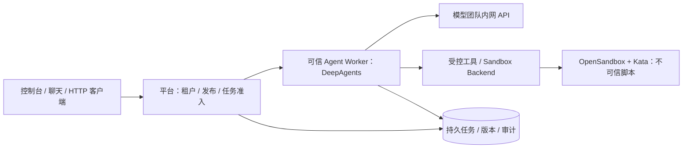

# Agent 主执行引擎评估：DeepAgents 与 OpenCode Server

日期：2026-11-03。状态：工程选型建议，未完成内网模型 A/B 与生产隔离验收。

## 结论

建议一期使用 **DeepAgents SDK 作为通用 Skill Agent 主执行引擎**，复用 Astron 的控制台、管理后端和 Python 执行链。OpenCode Server 保留为未来编程/代码仓库任务的候选执行后端，首期不同时维护两套通用运行时。

这个结论针对企业离线、多租户、租户可上传不可信 Python/Shell 的需求。它不是对两个框架模型效果或吞吐的实测排名。若未来产品重心变为在线编程工作台，或内网 OpenCode 服务已经交付独立租户隔离和受控远程工具执行，本结论需要重新评估。

用户估计内网版本为“2.2，最新版本”，尚未读取真实二进制版本、镜像摘要和 API 契约；本报告依据官方 **V2 文档**评估，不将 V1 配置直接用于 V2。当前代码仅声明 `deepagents==0.7.29`，本次未安装或升级它；采用最新文档能力前仍须核对该锁定版本的实际 API。

## 已核验的事实

1. 两者都能处理所需 Skill 形式。DeepAgents 文档支持 `SKILL.md` 及 scripts/references/assets，按需读取，脚本需受控执行环境；OpenCode V2 同样支持 Skill 目录与相对资源，含全局和项目级发现。支持 Skill 不能单独决定主引擎选择。[DeepAgents Skills](https://docs.langchain.com/oss/python/deepagents/skills)、[OpenCode V2 Skills](https://opencode.ai/v2/docs/skills/)
2. DeepAgents 提供可插拔文件/执行 backend，可把文件操作和命令送往独立 sandbox；SDK 可自行托管，未要求购买 Managed Deep Agents 或 LangSmith 托管服务。[Backends](https://docs.langchain.com/oss/python/deepagents/backends)、[Sandboxes](https://docs.langchain.com/oss/python/deepagents/sandboxes)、[部署选择](https://docs.langchain.com/oss/python/deepagents/overview)
3. OpenCode V2 有正式 HTTP API 和生成的 TypeScript 客户端 `@opencode/client`，支持会话、消息、Skill 激活、中断和事件等。已有内网实例可以降低受信场景的接入成本。[官方客户端](https://opencode.ai/v2/docs/build/client/)、[API](https://opencode.ai/v2/docs/api)
4. OpenCode 官方安全模型明确说明权限确认不是安全沙盒。V2 的外部目录默认允许行为也与 V1 不同，需要配置并通过 OS/VM 边界保护；项目/全局配置和插件加载必须纳入威胁模型。[SECURITY.md](https://github.com/anomalyco/opencode/blob/dev/SECURITY.md)、[V2 迁移说明](https://opencode.ai/v2/docs/migrate-v1/)
5. OpenCode V2 已支持持久输入接入和 inbox；全局 `/api/event` 是易失通知，断连会丢事件；可按序读取的持久 session log 仍在 experimental 路径。不能把实时流直接当作平台审计账本，也不能说 V2 完全没有持久化能力。[API 契约](https://opencode.ai/v2/docs/api)
6. 两者可通过配置连接模型团队已有接口；DeepAgents 对模型的工具调用兼容性有要求，OpenCode V2 支持自定义 provider endpoint。此选择不增加模型部署、网关、推理或 GPU 调度职责。[DeepAgents Models](https://docs.langchain.com/oss/python/deepagents/models)、[OpenCode V2 Providers](https://opencode.ai/v2/docs/providers/)
7. 当日 GitHub 页面显示 OpenCode 约 224.2k stars、DeepAgents 约 30.9k stars，主仓库均为 MIT；都满足主要组件 >=1k stars 的门槛。传递依赖及可选商业服务仍须逐项审查。[OpenCode 仓库](https://github.com/anomalyco/opencode)、[DeepAgents 仓库](https://github.com/langchain-ai/deepagents)

## 面向本项目的比较

以下适配成本和偏好为基于上述能力及本地代码的工程判断，没有虚构工期、性能或效果评分。

| 维度 | DeepAgents SDK | OpenCode Server | 本项目影响 |
|---|---|---|---|
| SKILL.md + 资源/脚本 | 原生支持，执行通过 backend/tools | 原生支持，现成文件/Shell 工具链 | 两者均满足，版本治理仍由平台负责 |
| 通用业务工具 | 直接注入受控 tools/middleware | 通过内置工具、插件、MCP 扩展 | DeepAgents 更便于把业务授权放在每次工具调用前 |
| 编程工作台 | 需组合代码工具和界面 | 已有代码、Shell、会话、项目工作流 | 编程为主要用途时 OpenCode 更值得优先验证 |
| HTTP 与聊天接入 | 在现有 FastAPI/管理 API 上封装 | 已有 HTTP 服务和官方客户端 | OpenCode 的现成接口占优；DeepAgents 可复用既有服务 |
| 不可信代码 | 框架不是隔离设施；可接远程 sandbox backend | 框架权限不是隔离设施；本地工具需整体隔离或改接远程执行 | 两者都要沙盒，DeepAgents 更贴近当前隔离设计 |
| 凭据边界 | 可信 worker 保管模型凭据，沙盒只收工具输入 | 整体搬进沙盒时须额外处理同环境凭据暴露；或隔离本地工具并重接远程工具 | DeepAgents 路径较直接 |
| 状态与恢复 | LangGraph checkpointer 提供基础，需配置持久存储和幂等 | V2 有持久 inbox/log；会话、输入、执行状态需映射到平台任务 | 两者都不能替代企业任务准入、授权与审计 |
| 租户与并发 | 平台控制 thread/run、配额和 backend 生命周期 | 平台控制 session/instance、配额和工作区隔离 | Session 或 thread ID 都不是安全边界 |
| 既有代码复用 | Astron 已有 DeepAgents runner 与 Skill 工具桥接 | 新增远程适配器、实例治理、事件转换和版本契约 | 目前 DeepAgents 增量改造更少 |
| 离线交付 | 打包 Python 依赖、内网模型和私有 sandbox | 打包二进制/插件/运行依赖并关闭公网功能 | 两者都须断网冷启动验收 |

## 决定推荐的边界

推荐架构让 DeepAgents 在可信 worker 内运行，仅通过模型 API 进行推理；租户脚本由远程沙盒执行，不能被 import/eval 到 worker 进程。Skill 中的说明和脚本均不能覆盖平台授权或注入任意服务端插件。

这是建议目标架构，OpenSandbox/Kata 的 SDK、版本与集群兼容性仍要实现验证，不能将图视为已交付功能。

若改为 OpenCode 主引擎，需要先选清楚以下执行方式：

- 整个 OpenCode 运行在任务隔离环境：能保护控制面与其他租户，但其可访问的本地凭据/配置仍可能被同环境任意代码读取。必须验证凭据隔离或任务级受限身份，不能把长期模型密钥写进共享 HOME。
- OpenCode 在可信区，文件/Shell/MCP 工具全部经受控远程执行：可以满足同样边界，但必须确保关闭或替换所有本地执行入口，并验证服务 API、插件和配置不能绕过。具体 V2 扩展支持和改造成本尚未实测。

现有平台承诺模型密钥不进入租户代码沙盒；不能为复用 OpenCode 悄悄降低这条要求。若凭据需求只能通过增加模型代理网关满足，则需要重新讨论范围，不能默认把该网关列入本项目。

## 本地代码核对

- [pyproject.toml](../../core/agent/pyproject.toml)：声明 `deepagents==0.7.29`。
- [deepagents_runner.py](../../core/agent/engine/deepagents_runner.py)：已有 `create_deep_agent` 和 `StateBackend()`；调用处没有配置持久 checkpointer。当前还过滤 `task` 工具，不能推定自主子 Agent 委派已开放。
- [skill.py](../../core/agent/service/plugin/skill.py)：通过 `read_skill_*` 与 `run_skill_*` 提供 Skill 读取/执行；不是“仓库完全没有 Skill 支持”。当前 runner 未直接传入原生 `skills=`，需要明确选择原生加载与现有桥接的收敛方式。
- [skill_sandbox.py](../../core/agent/service/plugin/skill_sandbox.py)：现有执行依赖 E2B provider，需落实私有沙盒适配。
- [SpringAiAgentChatService.java](../../console/backend/hub/src/main/java/com/iflytek/astron/console/hub/service/chat/springai/SpringAiAgentChatService.java)：独立聊天还有 Java 路径；选 DeepAgents 主引擎也需要做统一运行契约与兼容迁移，不能只改 Python 就宣布统一完成。

## 对已有 OpenSpec 的影响

七项企业能力仍需要实现。推荐沿用 DeepAgents 后，下一轮设计细化应明确：

1. Skill 不可变 release 如何投影到运行时：元数据选择、按需读取、资源传输、脚本执行及依赖锁定；禁止运行中读取可变草稿。
2. 将现有 Skill 工具桥接与官方 Skill 能力收敛为一套加载约定，保留兼容窗口，避免双重注入造成工具/提示重复。
3. 统一可信运行上下文 `tenant/environment/agent_version/skill_release/run_id/attempt`；客户端不能指定他人 thread/session。
4. 接持久 checkpointer 并定义恢复与副作用幂等；平台任务状态仍负责准入、配额、取消、期限和审计。Temporal 如采用，管理外层任务生命周期，不重复实现每个 Agent 内部步骤的状态机。
5. 外部 HTTP API 保持平台自己的稳定契约；引擎替换不让调用方改用框架私有接口。可保留轻量 runtime adapter 边界，首期只实现 DeepAgents。

本次仅新增评估，不更换依赖、不启动第二引擎，也未将待实施任务标记为完成。

## 选型验收方案

若对实际任务效果仍有疑问，应使用相同内网模型、同一 Skill release、相同输入与预算进行小规模 A/B。产品需求未限定为编程，因此样本必须包括通用任务。

| 验证内容 | 通过依据 |
|---|---|
| Skill 加载与资源相对路径 | 能按需选择正确 Skill，脚本和资源可用，版本摘要不漂移 |
| 文档、结构化数据、业务 API 与代码任务 | 用固定输入和可机验结果对比正确率、工具参数及产物，而非只看回答流畅度 |
| 模型协议 | 文本、结构化工具调用、流式输出、超时/限流和上下文限制通过契约样本 |
| 双租户与同 Agent 并发 | 文件、会话、日志、密钥与产物不可越权读取；配额不超发 |
| 不可信代码 | 不能读取模型/平台凭据、宿主文件、其他任务目录或访问未授权网络 |
| 断连、重启和取消 | 可追踪真实终态；未知外部副作用不自动重放；资源释放且不重复提交 |
| 全离线运行 | 从制品冷启动到 Skill 执行与结果查看无公网依赖 |
| 成本与运维 | 记录实际 CPU/RSS、启动时间、任务时延、模型调用量和排错工作量 |

其中租户隔离、凭据保护、取消与副作用处理是硬门槛，不能用任务正确率优势抵消。本次未连接用户内网 OpenCode 或内网模型，尚无上述实测数据。
