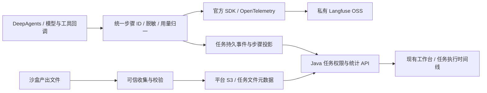

# Agent 执行观测选型与交付契约

核验日期：2026-11-05。新增要求是观察任务如何读取上下文、选择 Skill、调用模型/工具以及形成产出，而不仅是主机资源监控。Agent 观测顶层候选需 **超过 5,000 GitHub Stars**。下列数值来自当日官方仓库页面，属于四舍五入显示；匿名 REST API 本次不可用，未将其写成精确计数。

## 选型结论

首选 **Langfuse OSS 的执行观测能力 + 现有平台的任务权限、持久事件和统计页面**；MLflow 为 Apache-2.0 的完整替代方案。保留现有 Prometheus 主机/执行健康监控。文件归档复用平台 S3 对象存储，独立于观测后端的 trace 保留策略。以下是研究和实现决策，尚未宣称新增组件已部署或逐步观测、月报、附件已验收。

| 项目 | Stars | 许可范围 | 能力与适用性 |
|---|---:|---|---|
| [Langfuse](https://github.com/langfuse/langfuse) | 37k | 核心 MIT；`ee` 等目录另有企业许可 | LLM/Agent/工具/检索 observation，Token、耗时、层级 trace、指标 API 和仪表盘；具有官方 DeepAgents 集成，首选 |
| [MLflow](https://github.com/mlflow/mlflow) | 28.7k | Apache-2.0 | 自托管 tracing、每步输入输出/Token/耗时，Usage 与 Tool Calls 仪表盘；完整备选，只用 tracing，不引入其模型服务/网关 |
| [SigNoz](https://github.com/SigNoz/signoz) | 32.5k | 核心 MIT；`ee`、`cmd/enterprise` 另有许可 | 统一 logs/metrics/traces，现有 AI Observability 支持模型/工具 Token、时延和聚合；企业已有此平台时可作为统一后端 |
| [OpenLLMetry](https://github.com/traceloop/openllmetry) | 7.5k | Apache-2.0 | OpenTelemetry 插桩 SDK，支持模型、LangChain/LangGraph 等；必须配存储/查询界面，不能独立当作完整观测产品 |

许可依据：[Langfuse LICENSE](https://github.com/langfuse/langfuse/blob/main/LICENSE)、[MLflow LICENSE](https://github.com/mlflow/mlflow/blob/master/LICENSE.txt)、[SigNoz LICENSE](https://github.com/SigNoz/signoz/blob/main/LICENSE)、[OpenLLMetry LICENSE](https://github.com/traceloop/openllmetry/blob/main/LICENSE)。正式引入时仍需锁定版本/镜像摘要并审查其传递依赖，不能把仓库主许可覆盖到全部容器包。

[OpenLIT](https://github.com/openlit/openlit) 当日 2.9k，不满足新增门槛。[LangWatch](https://github.com/langwatch/langwatch) 显示 5.0k，无法据此确认严格大于 5,000，暂不进入严格通过名单。[Phoenix](https://github.com/Arize-ai/phoenix) 12.1k，功能相关，但当前主仓库是 [Elastic License 2.0](https://github.com/Arize-ai/phoenix/blob/main/LICENSE)，包含向第三方提供托管服务等限制，不按 MIT/Apache 宽松开源首选处理。

## 逐项覆盖与需要补齐的内容

| 用户要求 | 开源组件提供 | 本平台交付要求 |
|---|---|---|
| 单任务日志 | trace 事件、错误、结构化字段；SigNoz 另提供通用日志检索 | 用可信 run_id 关联任务事件和 trace；保留现有任务状态的唯一事实来源 |
| 感知与执行过程 | Agent、chain、retriever、generation 和 tool 层级 | 记录输入/上下文摘要、选用 Skill/版本/文件、步骤、依赖关系、状态、错误、可获得的决策摘要；不声称能读取模型不可返回的内部推理 |
| 工具调用过程 | 自动回调或 OTel span、输入输出、异常和时序 | 文件读写、Shell、插件、子任务均关联父步骤；参数和输出按权限、长度及脱敏策略展示 |
| 每步 Token | 模型 generation/span 的 usage | 逐次真实调用记录输入/输出/缓存字段及来源；纯工具步骤直接 Token 为 0；模型未报告为未知；估算必须显式标记 |
| 每步耗时 | span 时间线、延迟、错误指标 | 展示开始、结束、墙钟耗时及运行中状态；父子/并行步骤不能简单相加当作任务总耗时 |
| 周统计、月统计 | 可选时间范围、指标聚合 API、仪表盘 | 默认 Asia/Shanghai，自然周周一零点起、自然月一日零点起；支持本周/上周/本月/上月和导出，不能用最近 7/30 天替代自然周期 |
| 任务资料可看可下载 | 部分工具可附加多模态数据 | 任务产出另存平台 S3，文件元数据与 run_id/步骤绑定；任务未删除就保留，不能跟随 trace TTL 或沙盒删除 |

Langfuse 的 [observation 类型](https://langfuse.com/docs/observability/features/observation-types)、[DeepAgents 官方集成](https://langfuse.com/integrations/frameworks/langchain-deepagents)、[Token 计量](https://langfuse.com/docs/observability/features/token-and-cost-tracking)与[Metrics API](https://langfuse.com/docs/metrics/features/metrics-api)提供上述基础能力。其用量既可来自 provider，也可能由 tokenizer 推断；平台必须保留来源，避免把推断展示为实测。

MLflow 的[Tracing 概览](https://mlflow.org/docs/latest/genai/tracing/)明确记录中间步骤，其[仪表盘](https://mlflow.org/docs/latest/genai/tracing/observe-with-traces/dashboard/)包含用量、耗时、错误和工具调用统计。SigNoz 的 [AI Observability](https://signoz.io/docs/ai-observability/)和[LangChain/LangGraph 集成](https://signoz.io/docs/langchain-observability/)支持基于 OTel GenAI spans 的查看与分析。自然周期、平台租户授权及附件生命周期仍由本平台落实，不声称装完任意一款软件即可满足全部需求。

## 与当前代码的衔接

现状：`durable/executor.py` 调用 `DeepAgentsRunner`，后者已有官方 LangChain usage callback、模型 middleware 和 OTel span。当前持久事件仅保留工具完成名称及任务级 usage；摘要/压缩模型调用会汇总成额外节点，尚未形成完整逐调用事件视图。`platform_runtime/backend.py` 的文件下载用于 Skill/模型工具读取，最多 32 KiB，不能直接当作报表/PDF/表格归档能力。

目标路径：

主任务、attempt、父子步骤和调用 ID 由可信运行时绑定；API 校验任务成员权限和环境，不信任浏览器传入的 trace ID/对象 key。Langfuse 控制台作为内部运维界面；不向普通租户提供共享项目 API key 或可绕过平台权限的直连链接。使用官方 SDK/回调，保留 OTel 兼容性；避免同时启用多套自动插桩导致重复 Token。

计量以模型叶子调用为基准，输入/输出/缓存字段保留原始口径。父步骤汇总是派生展示，不能再次计入任务/周期总量。失败重试实际发生的模型调用仍计费；仅事件投递重试按稳定键去重。旧任务未采到的逐步数据标记“未记录”，不从任务总量平均摊分。任务数量按创建时间统计，用量按调用结束时间归属周期，界面说明跨周期任务的差异。

观测后端暂时不可用不得触发模型/工具重放。使用有限队列/持久 outbox 和脱敏告警记录缺口；不能以 SDK 的异步发送等同于绝不丢失。强制终止时允许步骤标记中断，不能伪造完成或 0 Token。

## 私有化和许可边界

Langfuse 官方说明[不要求互联网访问](https://langfuse.com/self-hosting/security/networking)。其[自托管架构](https://langfuse.com/self-hosting)需要 Web、Worker、Postgres、ClickHouse、Redis/Valkey 和 S3；优先用许可明确的 Valkey 和现有兼容对象存储，逐项验证，不照搬含不合适依赖的示例。禁用产品遥测、在线更新检查及所有公网目的地；模型仅调用企业接口，AI Gateway 不在本项目范围。

[企业许可文档](https://langfuse.com/self-hosting/license-key)把项目级 RBAC、审计、保留策略和服务端脱敏等列为 EE。所需租户权限、审计和采集前脱敏由本平台独立实现，不能以屏蔽界面或绕过许可开启 EE。OSS core 的能力足够作为 trace 后端，仍须对实际锁定版本做自托管契约测试。

[官方 Compose 指南](https://langfuse.com/self-hosting/deployment/docker-compose)建议至少 4 核、16 GiB 内存。当前共享展示机约 7.3 GiB，不能把建议配置视为当前机器已有资源，也不能直接挤占现有应用。先完成平台步骤/附件闭环及受限资源实测，再确定演示后端部署；生产在独立 CPU 节点/企业监控资源池部署。此资源判断不涉及模型推理容量。

## 验收

新增 OpenSpec：`observe-agent-execution` 与 `retain-task-artifacts`。必须验证并发任务串链、跨租户/环境访问、重复上报、流式 usage、缺失计量、重试、取消/崩溃、跨周/月边界、对象存储故障及沙盒回收后下载。至少保留一条真实 Skill 任务的逐步执行证据和可下载文件摘要，再标记交付。
