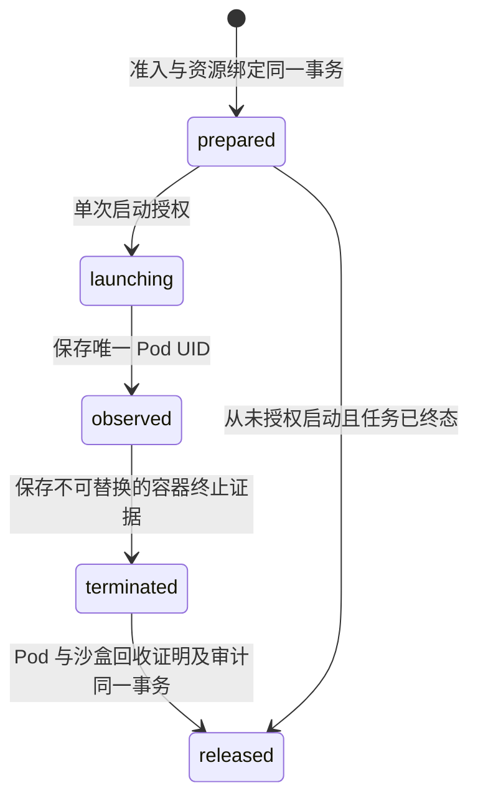

# Kubernetes 执行接入

当前增量实现集群执行的控制面账本、独立服务接口和 Python 严格传输，复用既有 RunLedger、配额、终态、SandboxJournal、Skill 验证与审计。尚未实现可启动 Pod 的集群监督器、finalizer 处理和 OpenSandbox/Kata 物理核验；专用 Helm 继续关闭新任务准入。单机展示仍使用已验收的 systemd/OpenSandbox/gVisor 执行链。

## 调用路径与身份

目标调用路径为 Temporal → 集群监督器 → 控制面账本 / Kubernetes 官方客户端 → 每次租约的可信 executor Pod → 模型接口 / 独立不可信代码沙盒。本增量实现监督器到控制面的协议，尚未接通 Kubernetes API。executor Pod 与租户代码沙盒是不同资源，不能把可信 executor 的容器停止当成沙盒停止。

仅 `reconciler` 服务身份能访问 `/internal/platform/reconcile/cluster/*`；普通 JWT、worker、dispatcher、observer 均不能提交证明。`PLATFORM_CLUSTER_RECONCILERS` 默认为 `{}`，未配置身份不得领取集群任务。其键为监督身份 ID，值为下表中的部署目标；凭据仍从已有 `PLATFORM_SERVICE_KEYS` 注入，不放在请求、Pod 标签或 Temporal 载荷中。

| 字段 | 来源与约束 |
|---|---|
| `workerId` | 已配置的独立 worker 服务身份，不与单机或另一集群监督器共用 |
| `environment` | `test` 或 `prod`，所有领取/查询请求必须匹配 |
| `clusterId` | 目标集群的受信标识；后续适配器需核验 Kubernetes 系统命名空间 UID，不能只信 URL 名称 |
| `namespace` / `namespaceUid` | 执行资源命名空间名称及实际 UID；跨环境不得共用相同集群/namespace UID |
| `executorImage` | 经审核的 `repository@sha256:...`，不能使用可变 tag |

目标信息随租约持久保存。已存在尝试期间不能用同一监督身份更换集群、namespace UID、worker 或镜像；配置不一致明确拒绝操作，应保留原身份/目标直至清理完成，再登记新身份。控制面中没有 Kubernetes token、kubeconfig 或集群管理员凭据。

## 状态与回收

`oa_run_cluster_execution` 通过 lease ID 引用既有 attempt，不产生第二套任务状态。任务成功/失败/取消与资源释放分开；取消或截止时间先 fencing，终态不反转。启动响应丢失时不能重试 `begin` 或据此重新创建 executor，需查询持久绑定并进入独立回收。

记录终止时要求相同 Pod UID、resourceVersion、节点名称/UID、`Succeeded`/`Failed` Pod 状态、`executor` 容器 ID、实际退出码和有时区的起止时间，以及独立证据摘要。resourceVersion 按不透明字符串保存，不转换为整数比较。终止记录在删除 Pod 前提交，并且只允许完全一致的重放；删除后、控制面重启后仍可查。最终证明必须匹配集群、namespace UID、Pod 名/UID、终止记录和 sandbox ID。

Kubernetes 的强制删除可能在节点进程仍运行时移除 API 对象，因此删除成功、404、NodeLost、空列表或 TTL 不能单独证明已停止。[Kubernetes 删除说明](https://kubernetes.io/docs/reference/kubectl/generated/kubectl_delete/)。后续执行适配器需要使用 finalizer 保留终止前的资源记录，且不能在节点失联时绕过核验。[Finalizers](https://kubernetes.io/docs/concepts/overview/working-with-objects/finalizers/)。当前未知启动和未知沙盒创建仍保留配额，尚未交付自动处置所有未知创建的机制。

单机和集群各自通过核验后，调用同一个事务内 `RunVerifiedRelease`：释放执行/沙盒配额、登记真实成功任务的同版本 Skill 验证与写入租户审计。审计或证明持久化失败必须回滚所有释放，不能部分释放或生成通过标记。

## 验证边界

2026-11-05：104 项 Java 检查最终通过（首轮两项测试数据/断言修正后定向复验），其中 76 项使用隔离 MySQL；27 项 Python 传输/单机兼容检查通过。数据库 SIGKILL/重启后，集群目标、Pod UID、终止记录仍可读取并幂等释放。展示 API 已应用 V1.62，未配置集群执行身份；实际 HTTP 的 6 类访问拒绝通过。升级后真实 DeepSeek + Skill 任务成功、180 条事件、脚本输出及物理回收证明通过；旧任务 58 个步骤、2 个文件摘要与 HTTPS 工作台复查通过。详见[验证记录](cluster-control-verification-20261105.json)。

MySQL/API 检查覆盖并发领取、一次性启动、跨身份/环境拒绝、资源 UID 固定、终止证据重放、未知状态保留配额、审计失败回滚、单机兼容和数据库重启。测试中的 Pod 元数据是合成契约数据，不能据此宣称真实 Pod 已终止。

Python 检查覆盖响应身份/状态一致性、分页、重复回收确认、秘密字段拒绝与启动授权不重试。它不包含模型请求或租户代码，也未依赖/安装 Kubernetes 客户端。下一步接官方客户端与 executor/finalizer 生命周期，再接沙盒物理核验、目标集群的 CNI/Kata、节点故障及离线端到端验收。

迁移 V1.62 仅新增集群绑定表，保留现有 systemd 监督字段与接口；回退应用时保留新表和已有记录。控制面就绪检查要求新表存在，旧任务及文件不清理。应用镜像交付包的版本/摘要仍以各自验收清单为准，不能将此前控制面镜像自动视为包含本增量。
