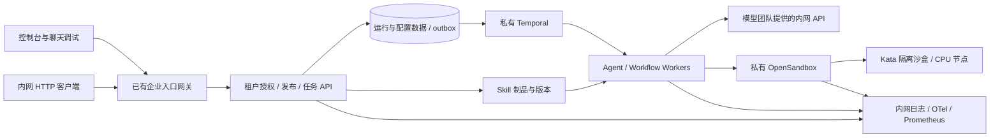

# 架构与实施顺序

状态：真实单机展示链路和 HTTPS 工作台已部署，项目仍在按 OpenSpec 完成企业交付。当前证据见 [真实工作台](live-console.md)；未宣称生产集群、完整离线交付和容量已验收。

图为目标架构。展示机 OpenSandbox/gVisor、Temporal 持久执行、真实模型和 Skill 执行、独立资源回收及浏览器聊天已验证；生产 Kata/K8S 未验收。当前证据见 implementation-progress.md。现有数据、身份和监控服务优先复用；模型系统只以 API 依赖出现。

| 阶段 | 变更 | 必要前置 | 完成标志 |
|---|---|---|---|
| P0 | [manage-tenant-access](../../openspec/changes/manage-tenant-access/proposal.md) | 现有认证/空间代码 | 双租户双环境权限矩阵通过，角色、配额、停用和审计可用 |
| P0 | [connect-internal-model-api](../../openspec/changes/connect-internal-model-api/proposal.md) | 配置授权对接租户上下文；mock 可先行 | Java/Python 均通过模型接口契约；真实内网接口验收 |
| P1 | [version-skill-releases](../../openspec/changes/version-skill-releases/proposal.md) | 租户/环境模型 | SKILL.md 包不可变、版本绑定与测试推广/回滚可追溯 |
| P1 | [isolate-private-skill-sandboxes](../../openspec/changes/isolate-private-skill-sandboxes/proposal.md) | 租户、Skill release；基础设施兼容验证可先行 | 不可信 Python/Shell 在隔离沙盒运行，越权与外联测试失败关闭 |
| P1 | [persist-agent-runs](../../openspec/changes/persist-agent-runs/proposal.md) | 租户配额、执行快照；模型/沙盒适配 | 持久状态、幂等、取消、配额、重启与未知副作用处理通过 |
| P2 | [publish-unified-agent-api](../../openspec/changes/publish-unified-agent-api/proposal.md) | 前述执行闭环 | 每个独立/工作流 Agent 均有 HTTP API，聊天复用同一任务链 |
| P2 | [deliver-offline-platform](../../openspec/changes/deliver-offline-platform/proposal.md) | 前述能力；离线清单、监控可提前准备 | 完整断网冷启动、test/prod 隔离、监控告警、备份恢复与压测验收 |

已从 `manage-tenant-access` 开始依次接通上述链路；后续继续补齐发布门禁、管理验收与交付运维，不改变最终联调前置关系。

## 任务与沙盒契约

准入保存 tenant/environment/deployment/release/config 快照 → 返回 run_id → 入队 → 取得执行配额 → 创建 attempt 和必要沙盒 → 调用模型与工具 → 持久事件/结果 → 回收沙盒和租约。模型调用走已有接口，用户代码只在沙盒运行。

运行状态：`queued → running → succeeded | failed | timed_out`；取消经 `cancel_requested → cancelled`。终态通过条件更新固定。接口断线不取消任务；取消必须显式请求。未知非幂等副作用不自动重试。

任务服务和沙盒适配器共同使用 run_id/attempt/lease 契约：任务服务拥有准入及终态，沙盒服务拥有执行资源生命周期。先用契约 stub 分别测试，再联合验收；不要互相创建第二套任务真相。

## 交付证据

每个变更至少保存：规格差异、实现提交、测试命令及结果、接口示例、迁移/回滚说明。跨租户隔离、沙盒网络、重启恢复与离线流程必须有真实环境证据。

不根据 120 张 H20 卡推算平台任务并发。平台容量以 CPU、数据库、沙盒启动/资源成本和模型 API 团队公布的限额为输入，通过压测给出。
